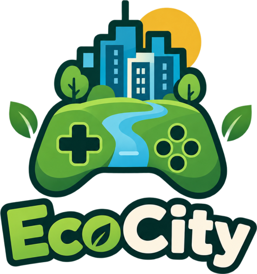
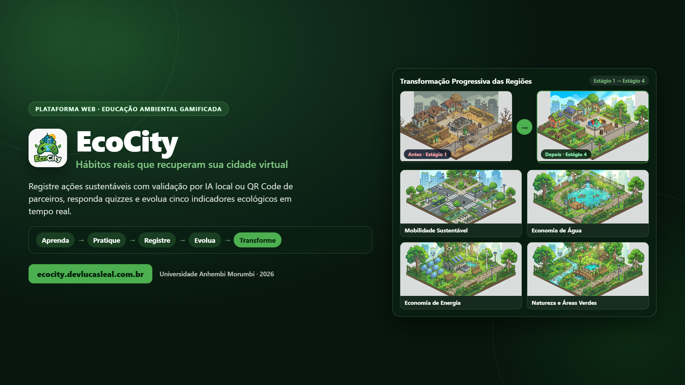
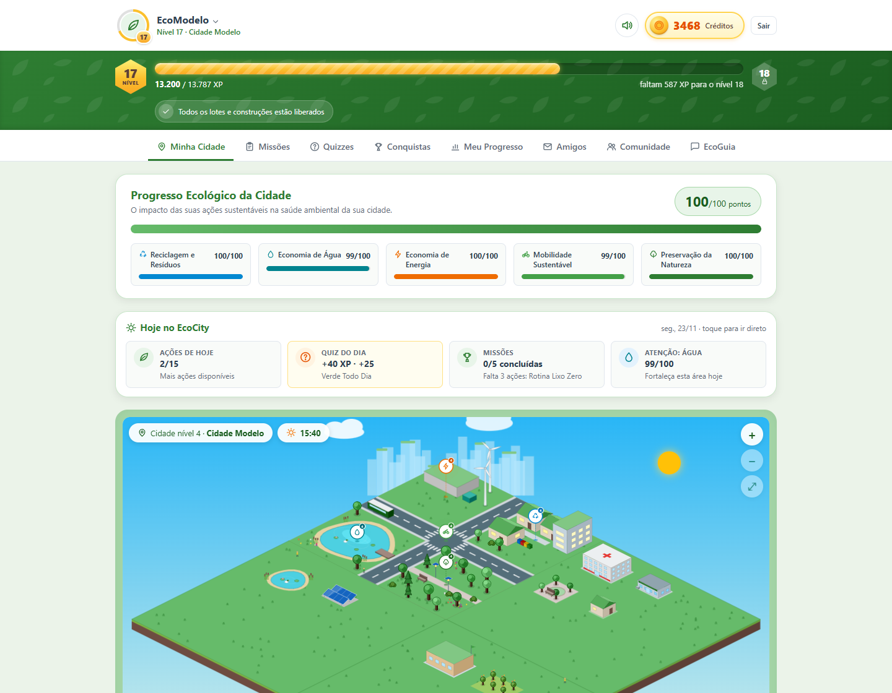
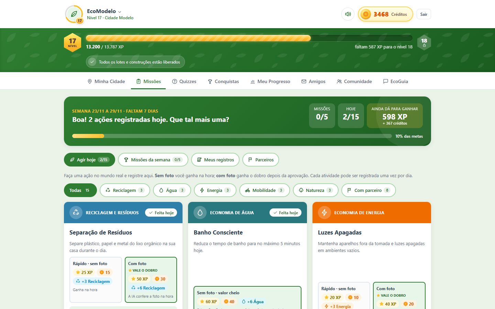
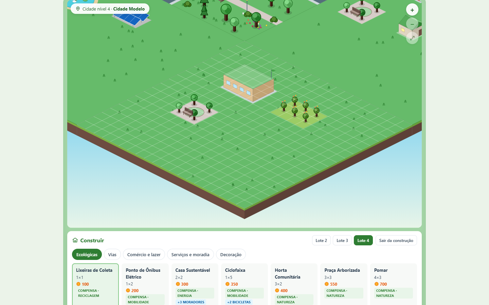
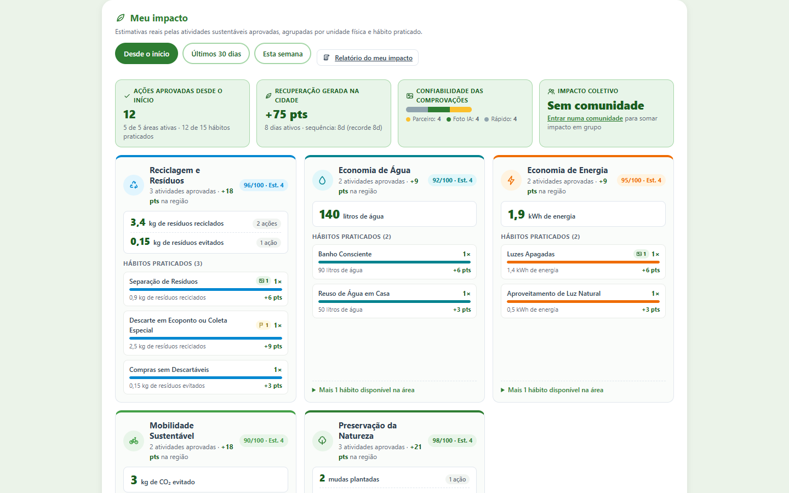
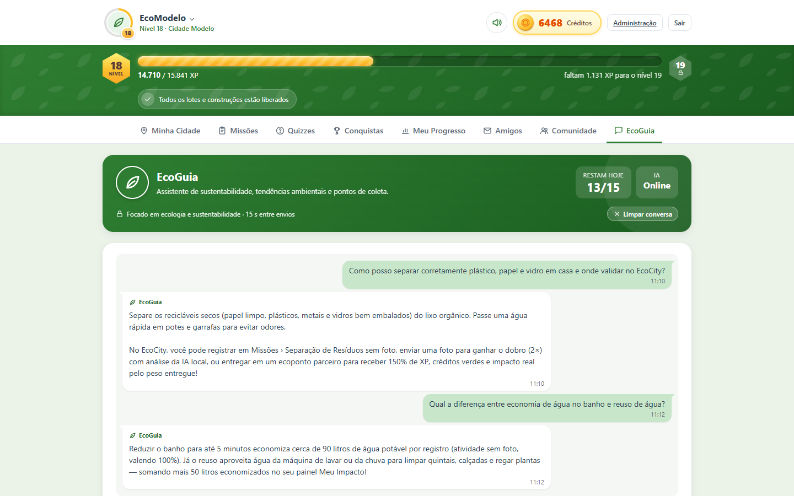
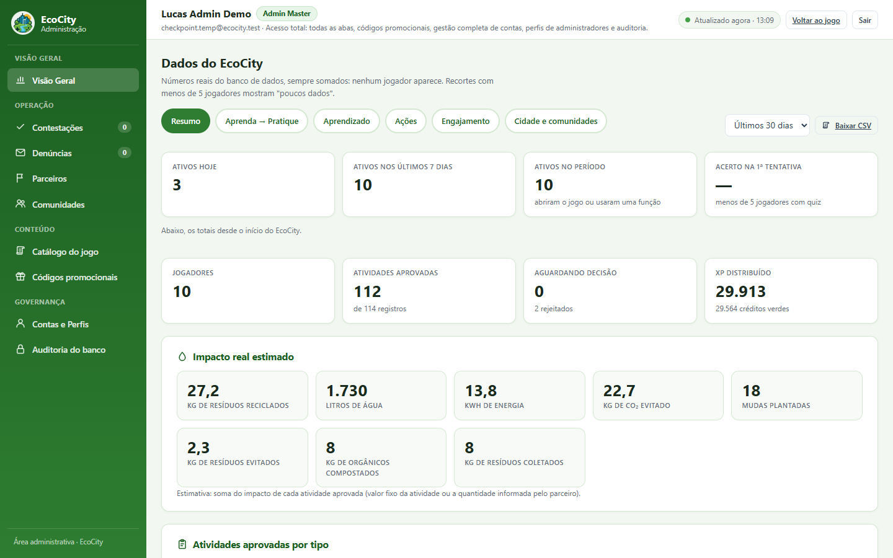
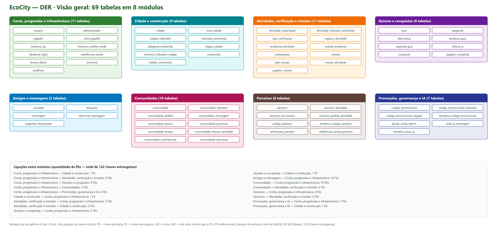

<div align="center">
  
  <h1>EcoCity</h1>
  <p><strong>Educação ambiental gamificada — transforme hábitos sustentáveis reais na evolução da sua cidade virtual.</strong></p>
  <p>
    <strong>Ciclo:</strong> Aprenda → Pratique → Registre → Evolua → Transforme
  </p>
  <p>
    
    
    
    
    
  </p>
  <p>
    <a href="#sobre-o-projeto">Sobre</a> ·
    <a href="#demonstração">Demonstração</a> ·
    <a href="#funcionalidades">Funcionalidades</a> ·
    <a href="#tecnologias-utilizadas">Tecnologias</a> ·
    <a href="#arquitetura-e-banco-de-dados">Arquitetura e DER</a> ·
    <a href="#estrutura-de-diretórios">Estrutura</a> ·
    <a href="#instalação-e-execução-local">Instalação</a> ·
    <a href="#equipe">Equipe</a>
  </p>
</div>

---

## Sobre o projeto

O **EcoCity** é uma aplicação web de **educação ambiental gamificada** desenvolvida como projeto acadêmico na Universidade Anhembi Morumbi (2026), voltada para jovens e adultos a partir de 13 anos.

### Problema que busca resolver
Existe uma distância prática entre *conhecer* conceitos de sustentabilidade e *mantê-los como hábito* no cotidiano. Ações individuais como separar resíduos, reduzir o tempo de banho ou economizar energia raramente geram retorno visual imediato, dificultando a continuidade.

### Proposta de solução
Cada jogador inicia com uma **cidade virtual em estágio degradado** e passa a recuperá-la ao responder **quizzes educativos** e registrar **ações sustentáveis reais** no dia a dia. Conforme essas ações são validadas, o jogador acumula **XP**, **créditos verdes** e impacto positivo em cinco indicadores ecológicos:

- **Reciclagem e Resíduos**
- **Economia de Água**
- **Economia de Energia**
- **Mobilidade Sustentável**
- **Preservação da Natureza**

> **Estágio do projeto:** aplicação funcional completa (frontend, backend PHP, banco MySQL 8.0, painel de parceiros, administração RBAC e suporte opcional a IA local e Docker), com algumas integrações externas ainda marcadas como opcionais ou planejadas (veja a seção [Funcionalidades](#funcionalidades)).

---

## Demonstração

<!-- Vídeo de apresentação: arraste o arquivo apresentacao/ecocity-apresentacao-github-720p.mp4 diretamente nesta seção no editor web do GitHub para gerar o player nativo. -->

<div align="center">
  
  <p><em>Evolução da cidade: estágio inicial degradado até os quatro estágios recuperados.</em></p>
</div>

<br>

| Minha Cidade (indicadores, *Hoje no EcoCity* e mapa isométrico) | Missões (*Agir hoje*, filtros por área e níveis de verificação) |
| :---: | :---: |
|  |  |
| **Modo Construir (39 estruturas e giro em 4 ângulos)** | **Meu Impacto (métricas reais multi-unidade)** |
|  |  |
| **EcoGuia (assistente educativo por IA local)** | **Administração (Visão Geral e perfis RBAC)** |
|  |  |

---

## Funcionalidades

### Implementadas

- **Cidade virtual isométrica em tempo real (`jogo.php`):** 5 regiões representadas por artes próprias em 4 estágios de recuperação (`assets/img/locais/`), mapa isométrico interativo em SVG com ciclo dia/noite, habitantes, veículos, fauna e coleta diária de renda do comércio.
- **Modo Construir:** 39 estruturas desbloqueadas pelo nível da cidade para posicionamento e rotação em 4 ângulos nos lotes de expansão (lotes 2, 3 e 4).
- **15 atividades sustentáveis e 3 formas de comprovação:**
  - *Rápido (sem foto):* autodeclarada (`50%` da recompensa — ou `100%` em ações domésticas sem foto possível, como *Banho Consciente* e *Torneira Fechada na Rotina*).
  - *Com foto:* analisada por visão computacional local (`100%` da recompensa, ou encaminhada ao administrador se a IA estiver desligada), com fluxo de **contestação** pelo jogador.
  - *Com código/QR de estabelecimento parceiro:* validada em ecopontos e cooperativas (`150%` da recompensa e cálculo de impacto real pela quantidade informada).
- **Quizzes e Educação:** Quiz do Dia, quizzes semanais/temáticos, histórico de revisões com fontes e explicações por alternativa e geração semanal opcional por IA a partir de notícias (RSS).
- **Missões e Conquistas:** 5 missões semanais elaboradas (3 metas cada), missões especiais do calendário ambiental e sala de troféus com raridades (Bronze, Prata, Ouro e Esmeralda).
- **Meu Progresso e Minha Conta:** painéis *Meu Impacto* multi-unidade (`kg`, `L`, `kWh`, `kg CO₂`, `mudas`), *Minha Evolução* (curvas de 8 semanas e comparativo *Antes × Agora*), *Meu Aprendizado*, Extrato paginado, relatório para impressão (`relatorio.php`), exportação de dados em JSON (LGPD) e ajuste granular de volumes por canal (Web Audio API com sons CC0).
- **Social e Comunidades:** busca por código público (`ECO-XXXX-XXXX`), solicitações de amizade, mensagens de texto com bloqueio/denúncia, **visita viva** à cidade de amigos, comunidades de até 30 membros com chat, mural de tópicos/eventos, missões coletivas e ranking.
- **EcoGuia (8ª aba):** assistente educativo sobre sustentabilidade alimentado por IA local com proteção contra sobrecarga e guardrails em camadas.
- **Área do Parceiro (`parceiro.php` e `validar.php`):** painel para administradores do estabelecimento (Visão Geral, relatórios e gestão de funcionários) e *Modo Balcão* para geração de códigos de 6 dígitos e QR Code em tela cheia.
- **Administração (`admin.php`):** menu lateral com **5 perfis de acesso RBAC** (`Master`, `Moderador`, `Editor`, `Parceiros`, `Analista`), gestão de contestações, denúncias (com triagem assistida por IA), catálogo do jogo, **gerador 3D de estruturas por IA**, códigos promocionais, gestão de contas 360° e auditoria detalhada do banco.
- **PWA instalável:** manifesto (`manifest.json`), ícones dedicados, *Service Worker* (`sw.js`) e página `offline.html` (sem cache de páginas PHP autenticadas).

### Opcionais / Parciais (dependem de serviços externos no ambiente)

- **IA local com Ollama:** a análise automática de fotos, geração semanal de quizzes/missões por IA, triagem de denúncias, modelagem 3D no admin e o chat EcoGuia exigem Ollama local (`qwen3-vl:8b-instruct` e, opcionalmente, `qwen2.5-coder:14b`). Sem Ollama ativo (`'ia' => ['ativo' => false]` em `config/config.local.php`), o sistema continua operando normalmente com revisão humana das fotos.
- **Envio de e-mails (PHPMailer 6.9.3):** exige credenciais SMTP em `config/config.local.php` (ou `docker/.env`). Em desenvolvimento local com `'debug' => true` e SMTP vazio, o link de redefinição de senha é exibido diretamente para testes.

### Planejadas (ainda não implementadas)

- **Login com Google (OAuth).**
- **Regras manuais externas de borda** (WAF / Rate Limiting na Cloudflare quando exposto na internet via túnel).

---

## Tecnologias utilizadas

| Camada | Tecnologias e versões | Função no sistema |
| :--- | :--- | :--- |
| **Frontend** | HTML5, CSS3, JavaScript (ES Modules) | Interface responsiva em 8 abas, cidade isométrica e gráficos próprios em SVG, Web Audio API e PWA (`manifest.json` + `sw.js`). |
| **Backend** | PHP **8.2** (PDO, GD, EXIF, cURL, mbstring) | Toda a regra de negócio, autenticação por sessão, proteção CSRF, cabeçalhos CSP com `nonce`, endpoints JSON (`api/`) e controle de acesso. |
| **Banco de Dados** | MySQL **8.0** (`InnoDB`, `utf8mb4`) | Persistência relacional com **69 tabelas**, **122 chaves estrangeiras**, **92 CHECKs**, **165 triggers**, **13 views**, **11 procedures**, **3 functions** e **1 event diário**. |
| **Bibliotecas integradas** | PHPMailer **6.9.3**, qrcode-generator **1.4.4** | Envio opcional de e-mails de redefinição de senha via SMTP e geração de QR Codes no navegador sem dependências de CDN externo. |
| **Infraestrutura opcional** | Docker, Apache, Ollama, Cloudflare Tunnel | Containerização para publicação contínua e execução local de modelos `qwen3-vl:8b-instruct` e `qwen2.5-coder:14b`. |

---

## Arquitetura e banco de dados

Toda regra crítica (cálculo de recompensas, XP, créditos verdes, níveis, prazos, aprovação de ações, limites e permissões) é executada no **backend PHP** e reforçada por **triggers, constraints e procedures no MySQL 8.0** — o JavaScript atua apenas na camada de apresentação e interatividade.

- **Frontend (`*.php` + `assets/js/`):** páginas PHP renderizam o esqueleto autenticado com `nonce` CSP; módulos JavaScript consomem endpoints JSON em `api/` com token CSRF e atualizam o estado via sincronização incremental (`api/sincronizar.php`).
- **Backend (`includes/` + `api/`):** valida sessão, permissões, limites de tentativa por IP e regras de negócio antes de persistir em transações MySQL.
- **Banco de Dados (`database/`):** estruturado até a **3ª Forma Normal (3FN)**, com chaves estrangeiras `RESTRICT`, auditoria imutável em tabela dedicada e `sp_verificar_integridade()` para conferência de consistência entre saldos e históricos.

<div align="center">
  
  <p><em>Visão geral do DER: 69 tabelas e 122 chaves estrangeiras organizadas em 8 módulos.</em></p>
</div>

- Diagrama completo editável (9 abas): [apresentacao/ecocity-der.drawio](apresentacao/ecocity-der.drawio) (abrir em [app.diagrams.net](https://app.diagrams.net/))
- Diagramas por módulo em PNG: [apresentacao/der/](apresentacao/der/)
- Plano de segurança, perfis e backup do banco: [specs/banco-de-dados.md](specs/banco-de-dados.md)
- Regras de negócio completas e design system: [specs/site.md](specs/site.md) e [specs/design.md](specs/design.md)

---

## Estrutura de diretórios

```text
ecocity2/
├── api/                    # Endpoints JSON autenticados com validação CSRF
├── apresentacao/           # DER (.drawio e PNGs), capa e capturas de tela do projeto
│   ├── der/                # Diagramas do DER por módulo (der-0.png a der-8.png)
│   └── screenshots/        # Capturas reais do sistema
├── assets/
│   ├── css/                # Folhas de estilo (base, auth, game, admin, parceiro, relatorio)
│   ├── img/                # Logotipos, ícones PWA e estágios das 5 regiões
│   ├── js/                 # Módulos ES6 (cidade isométrica, UI, gráficos SVG, áudio, PWA)
│   ├── sons/               # Efeitos sonoros e ambientes CC0 (MP3 e OGG)
│   └── vendor/             # Recursos estáticos auxiliares
├── config/
│   └── config.example.php  # Modelo de configuração local (copiar para config.local.php)
├── database/
│   ├── ecocity.sql         # Estrutura completa do banco (tabelas, views, triggers, procedures)
│   ├── 002-*.sql .. 045-*.sql  # Histórico completo de migrações SQL numeradas
│   └── projeto/            # Scripts modulares da entrega (01-criar-banco a 09-monitoramento)
├── docker/                 # Dockerfile, docker-compose.yml e modelo .env.example (opcional)
├── includes/               # Núcleo PHP (bootstrap, autenticação, regras de negócio, IA, RBAC)
├── lib/PHPMailer/          # Biblioteca PHPMailer 6.9.3 (envio SMTP opcional)
├── specs/                  # Especificações técnicas (site, design, banco de dados)
├── uploads/                # Diretório para fotos enviadas (bloqueado contra execução PHP)
├── jogo.php                # Aplicação principal do jogador (8 abas)
├── admin.php               # Painel administrativo com perfis RBAC
├── parceiro.php            # Portal de gestão e Modo Balcão dos estabelecimentos parceiros
├── validar.php             # Validação de QR Code de parceiro pelo celular
├── relatorio.php           # Relatório ecológico individual para impressão/PDF
├── login.php / cadastro.php / sobre.php  # Acesso público e apresentação acadêmica
└── manifest.json / sw.js / offline.html  # Suporte a PWA instalável
```

---

## Instalação e execução local

As instruções abaixo configuram uma **instalação limpa e independente** na sua própria máquina, sem dependência de dados privados ou credenciais de produção.

### Pré-requisitos
- **PHP 8.2** (ou superior compatível) com extensões habilitadas: `pdo_mysql`, `gd`, `mbstring`, `curl` (e `exif` recomendada).
- **MySQL 8.0** (com suporte a `utf8mb4` e `InnoDB`).
- Servidor web local como **WampServer**, **XAMPP**, **Laragon** ou servidor embutido do PHP para testes rápidos.

### 1. Clonar o repositório
Coloque o projeto na pasta servida pelo seu Apache local (por exemplo, `www/ecocity2` no WampServer ou `htdocs/ecocity2` no XAMPP):

```bash
git clone https://github.com/Lucas-Mendes-Leal/ecocity.git ecocity2
cd ecocity2
```

### 2. Criar e importar o banco de dados MySQL 8.0
Importe sempre usando `--default-character-set=utf8mb4` para preservar todos os acentos em português:

```bash
mysql -u root -p -e "CREATE DATABASE IF NOT EXISTS ecocity CHARACTER SET utf8mb4 COLLATE utf8mb4_unicode_ci;"
mysql -u root -p --default-character-set=utf8mb4 ecocity < database/ecocity.sql
mysql -u root -p --default-character-set=utf8mb4 ecocity < database/projeto/06-dados-teste.sql
```

*(Opcional)* Para expandir o catálogo de atividades de 5 para 15 ações sustentáveis e ativar as 5 missões semanais elaboradas:

```bash
mysql -u root -p --default-character-set=utf8mb4 ecocity < database/042-catalogo-atividades-missoes.sql
mysql -u root -p --default-character-set=utf8mb4 ecocity -e "UPDATE atividade_sustentavel SET aceita_parceiro = 0 WHERE atividade_sustentavel_id IN (2, 3, 8, 9, 10, 11, 12);"
```

#### Banco limpo (sem contas de demonstração)
O arquivo `06-dados-teste.sql` carrega o catálogo do jogo e também um conjunto de jogadores fictícios de demonstração (`@demo.ecocity.test`). Se preferir começar com **zero contas pré-existentes** e criar tudo do zero pela tela de cadastro:

```bash
mysql -u root -p --default-character-set=utf8mb4 ecocity -e "CALL sp_apagar_demonstracao(FALSE);"
```

Para promover a sua primeira conta cadastrada em `cadastro.php` ao perfil de **Administrador Master**:

```sql
INSERT INTO administrador (usuario_id, data_cadastro, ativo, perfil)
SELECT usuario_id, CURDATE(), TRUE, 'master'
  FROM usuario
 ORDER BY usuario_id ASC
 LIMIT 1;
```

### 3. Configurar a conexão local
Copie o arquivo de modelo e preencha apenas as credenciais do **seu** MySQL local:

```bash
# Linux / macOS / Git Bash
cp config/config.example.php config/config.local.php
```

```powershell
# PowerShell (Windows)
Copy-Item config\config.example.php config\config.local.php
```

Edite `config/config.local.php`:
- Informe `'user'` e `'pass'` do seu MySQL local em `'db'`.
- Ajuste `'url_base'` conforme o endereço usado no seu computador (ex.: `'http://localhost/ecocity2'` ou `'http://127.0.0.1:8000'`).
- Se não for rodar o Ollama localmente agora, defina `'ia' => ['ativo' => false]`.
- Para desenvolvimento local sem servidor SMTP, mantenha `'debug' => true` e deixe `'smtp'` em branco.

> **Segurança:** o arquivo `config/config.local.php` já está bloqueado no `.gitignore` para nunca ser versionado.

### 4. Iniciar e acessar no navegador
- **Com WampServer / XAMPP:** inicie o Apache e o MySQL e abra:
  `http://localhost/ecocity2/`
- **Ou com o servidor embutido do PHP** (na raiz do projeto):
  ```bash
  php -S 127.0.0.1:8000
  ```
  E acesse `http://127.0.0.1:8000/` (lembrando de ajustar `'url_base' => 'http://127.0.0.1:8000'` em `config/config.local.php`).

---

### Execução com Docker e publicação na web (opcional)
Caso deseje subir a aplicação em containers Docker (PHP 8.2 + Apache, MySQL 8.0, Ollama e túnel Cloudflare opcional), utilize os arquivos separados da pasta `docker/`:

1. Copie `docker/.env.example` para `docker/.env` (arquivo ignorado pelo Git) e defina senhas próprias e `URL_BASE`.
2. Coloque um dump inicial limpo em `docker/init/01-ecocity.sql` caso queira inicializar o container de banco na primeira execução.
3. Suba os serviços dentro de `docker/` com `docker compose up -d --build`.

Detalhes sobre perfis de acesso do banco, backups agendados e hardening de produção estão documentados em [specs/banco-de-dados.md](specs/banco-de-dados.md) e [docker/docker-compose.yml](docker/docker-compose.yml).

---

## Equipe

Projeto acadêmico desenvolvido em 2026 na **Universidade Anhembi Morumbi**, sob orientação dos professores **Cassilene Rodrigues de Assis** e **Flavio Copola Azenha**.

- **Lucas Mendes Leal** — Ciência da Computação · [LinkedIn](https://www.linkedin.com/in/lucas-mendes-leal-2b5b232a5)
- **Rosa de Sarom Diambo Vango** — Análise e Desenvolvimento de Sistemas · [LinkedIn](https://www.linkedin.com/in/rosa-vango-889351313/)

---

## Licença

Este projeto está licenciado sob a **Licença MIT** — consulte o arquivo [LICENSE](LICENSE) para mais detalhes.
